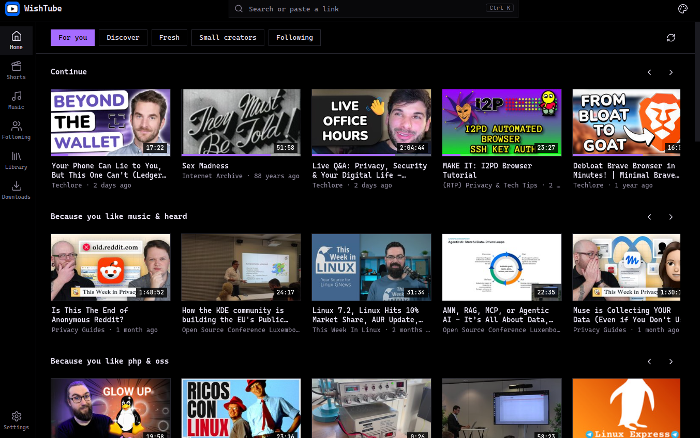
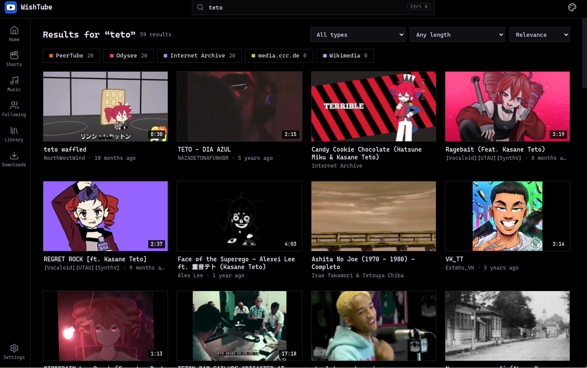
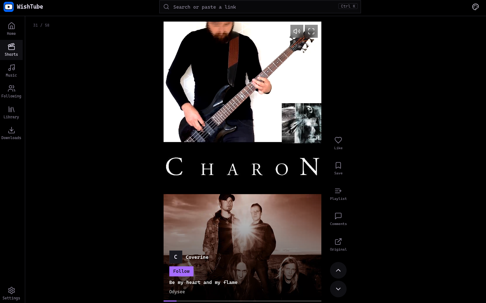
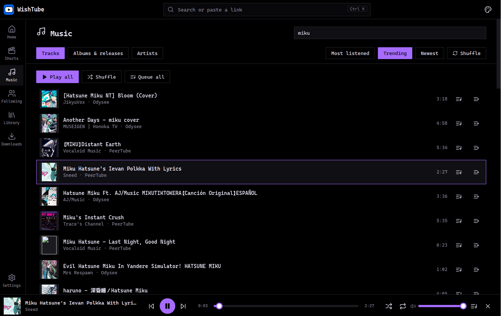
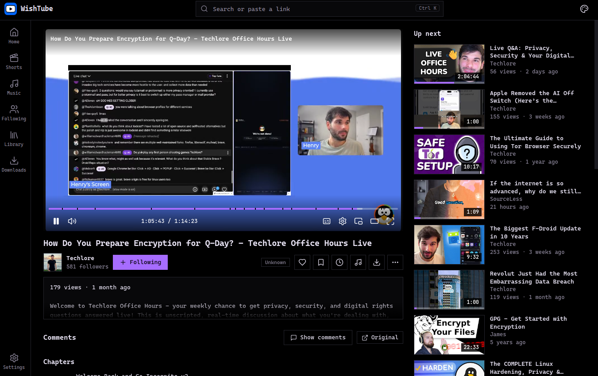
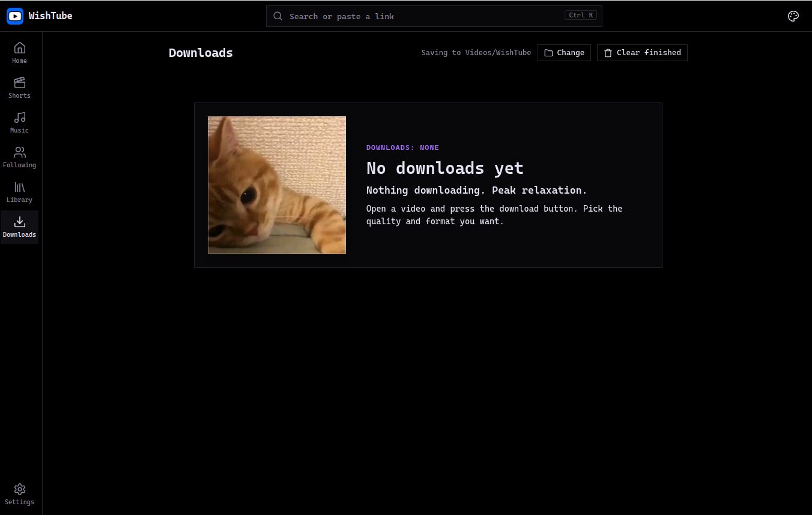
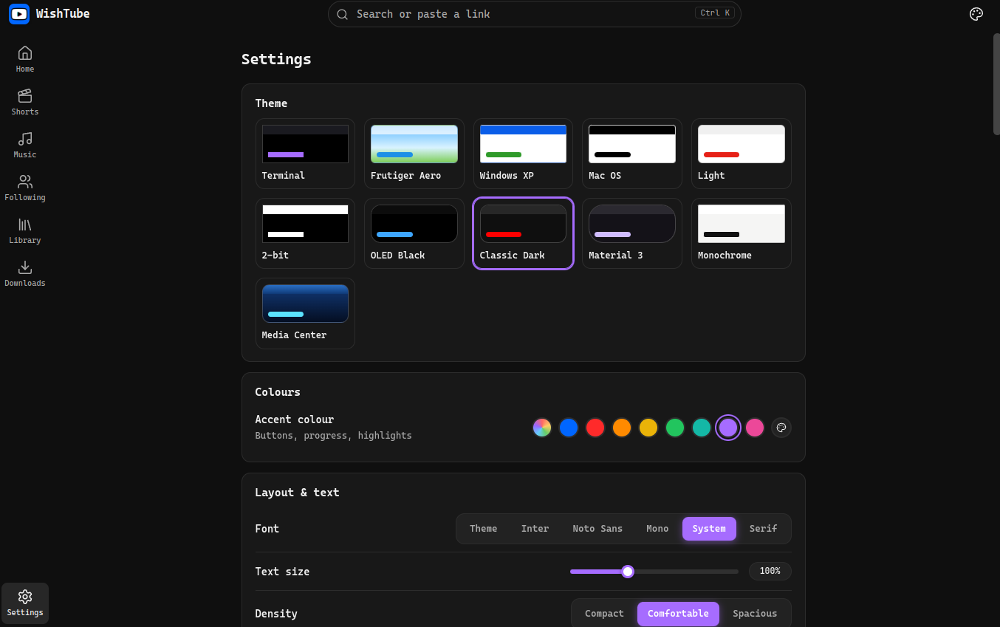

 <div align="center">


# WishTube Desktop

**A local-first video and music client for Linux, Windows and macOS.**

Discover videos, music and independent content from PeerTube, Odysee, Internet Archive, media.ccc.de and Wikimedia Commons — all in one clean app.

No account, no tracking, no server. Your recommendations stay on your device.

<p>
  <a href="https://github.com/wishissue/wishtube-desktop-source/releases">Download latest release</a> ·
  <a href="https://github.com/wishissue/wishtube-desktop-source/issues">Report a bug</a> ·
  <a href="https://github.com/wishissue/wishtube-desktop-source">Source code</a>
</p>


</div>

---

## Screenshots

<div align="center">

<table>
  <tr>
    <td align="center" width="50%">
      <b>Home Screen</b><br>
      
    </td>
    <td align="center" width="50%">
      <b>Discover & Recommendations</b><br>
      
    </td>
  </tr>
  <tr>
    <td align="center" width="50%">
      <b>Shorts Feed</b><br>
      
    </td>
    <td align="center" width="50%">
      <b>Music Library</b><br>
      
    </td>
  </tr>
  <tr>
    <td align="center" width="50%">
      <b>Video Player</b><br>
      
    </td>
    <td align="center" width="50%">
      <b>Download Manager</b><br>
      
    </td>
  </tr>
  <tr>
    <td align="center" colspan="2">
      <b>Themes & Customization</b><br>
      
    </td>
  </tr>
</table>

</div>

---

## What's New

- **Separate Videos, Shorts & Music:** Dedicated sections for each content type. A video is only a Short when its provider identifies it through a `shorts` tag or reported portrait dimensions. Music requires a provider Music category/tag or an audio item. Nothing is guessed from duration or title.
- **Music Player:** Tracks, albums/releases, artists/channels, search, queue, shuffle, repeat, background audio and mini-player. Internet Archive items include real tracklists.
- **Rebuilt Download Manager:** Resumable HTTP downloads, separate audio/video merging through FFmpeg without re-encoding, HLS, MP3/M4A/Opus extraction, retry, pause/resume, speed, ETA and download history. Every finished file is checked with ffprobe.
- **Comments:** Read-only comments for PeerTube, Odysee and Internet Archive reviews, with sorting, search, replies and links to original discussions.
- **Playlists & Search:** Playlists, video queue, library filters and search filters for type, duration, provider and sorting.
- **11 Built-in Themes:** OLED, Material 3, Media Center, Monochrome and more, with custom accent colours, fonts, text sizes, density, thumbnail sizes, corner radius, sidebar layouts and backgrounds.
- **Update Checker:** Daily GitHub release checks with Update now, Later and Skip this version, plus download progress and restart.
- **Simpler Loading:** Removed terminal-style activity logs, status pills and the "show what this player is doing" button. Loading now uses one animated logo ring and a plain sentence.
- **No Liquid Glass:** Removed the Liquid Glass theme, settings panel and transparent window code. Old saved settings switch to OLED Black.

### Earlier: 0.3.1

- **Fixed Loading Animation:** Loading indicators no longer freeze when system animations or reduced motion are enabled. Reduced-motion mode uses a calmer steady arc.
- **macOS Support:** Added Apple Silicon and Intel builds, proper menu bar shortcuts and update checker support.
- **Single Instance Fix:** A second launch no longer creates unnecessary windows, tray icons or media-key shortcuts.
- **IPC Fixes:** Fixed crashes involving fullscreen, always-on-top and dialogs when the macOS window is closed.
- **Cross-platform FFmpeg:** Fixed FFmpeg downloads to match the target operating system and CPU.

---

## Why WishTube?

Most video platforms rely on centralized recommendations, accounts and tracking. WishTube brings independent content sources together in one desktop application while keeping your data local.

- **Multi-source Discovery** — Explore content from multiple independent platforms in one place.
- **Local-first & Private** — Your viewing history, interests and recommendation model stay on your device.
- **No Account Required** — Start discovering and watching without signing up.
- **No Tracking** — No telemetry or centralized recommendation server.
- **Personal Recommendations** — Atlas learns from your behaviour and adapts to your interests.
- **Open Source** — Transparent codebase that you can inspect, modify and build yourself.

---

## Features

- **Multi-source Discovery:** PeerTube, Odysee, Internet Archive, media.ccc.de and Wikimedia Commons.
- **Atlas Recommendation Engine:** Up to 8 interest clusters, plus a 2-hour session vector.
- **Semantic Learning:** Learns relationships between words from fetched videos using on-device random indexing, so related topics can match.
- **Behaviour-based Ranking:** Finishing, opening, bouncing, skipping and not-interested signals influence recommendations. Ignored impressions count lightly.
- **Creator Exploration:** Thompson-style sampling explores uncertain creators without constantly reshuffling feeds.
- **Diversity Ranking:** MMR re-ranking with per-creator and per-source run limits.
- **Popularity Normalization:** Per-source popularity normalization, cross-source de-duplication and evergreen-aware freshness.
- **Transparent Recommendations:** Settings > Your taste displays interests and learned weights. Every card explains why it appears.
- **Video Player:** Full keyboard controls, HLS quality selection, Picture-in-Picture, chapters and captions.
- **Music Player:** Tracks, albums, releases, artists, queue, shuffle, repeat and background playback.
- **Shorts Feed:** Dedicated short-form content area based on provider metadata.
- **Download Manager:** Resumable downloads, FFmpeg merging, HLS, audio extraction, retry and progress tracking.
- **Comments:** Read-only comments, search, sorting and replies.
- **Playlists:** Playlists, video queue and library filtering.
- **Search Palette:** Ctrl+K local search, paste-a-link and content filters.
- **Customizable Themes:** 11 themes, accent colours, fonts, density, thumbnail sizes, layouts and custom backgrounds.
- **Desktop Integration:** System tray, media keys and single-instance support.
- **Profile Backup:** Export and import your profile.

> Content availability depends on individual providers. API changes, playback restrictions and supported formats may affect certain content.

---

## Install

1. Visit [WishTube Desktop Releases](https://github.com/wishissue/wishtube-desktop-source/releases).
2. Download the latest package for your operating system.
3. Install or launch WishTube.

Available packages:

- **Linux:** AppImage
- **Windows:** Portable executable and installer
- **macOS:** DMG and ZIP (Apple Silicon and Intel)

### Fedora / Linux

Make the AppImage executable:

```bash
chmod +x WishTube-*.AppImage
./WishTube-*.AppImage
```

If it complains about FUSE on Fedora:

```bash
sudo dnf install fuse fuse-libs
```

Alternatively, run without FUSE:

```bash
./WishTube-*.AppImage --appimage-extract-and-run
```

---

## Build from Source

### Requirements

- Node.js
- npm
- Git

### Run from Source

```bash
git clone https://github.com/wishissue/wishtube-desktop-source.git
cd wishtube-desktop-source

npm install
npm start
```

### Run Tests

```bash
npm test
```

### Build Release

**Linux**

```bash
npm run dist:linux
```

Output: `dist/WishTube-*-linux-x86_64.AppImage`

**Windows**

```bash
npm run dist:win
```

Output: Portable executable and installer.

**macOS**

```bash
npm run dist:mac
```

Output: DMG and ZIP for Apple Silicon and Intel.

DMG generation requires a Mac. To generate ZIP packages elsewhere:

```bash
npm run dist:mac:zip
```

**Build all platforms**

```bash
npm run dist
```

Builds Linux, Windows and macOS ZIP packages from Linux.

### Cross-building

Cross-building is supported:

- `scripts/before-pack.cjs` downloads the FFmpeg binary matching the target OS and CPU.
- `scripts/after-pack.cjs` ad-hoc signs the macOS application.

### Automated Releases

For properly built releases, push a version tag:

```bash
git tag v0.4.0
git push origin v0.4.0
```

GitHub Actions builds Linux, Windows and macOS releases on native runners.

### macOS First Launch

The macOS app is ad-hoc signed, not notarized (notarization requires a paid Apple Developer ID).

On first launch:

1. Right-click WishTube.
2. Select Open.
3. Select Open again.

If macOS reports that the application is damaged:

```bash
xattr -cr /Applications/WishTube.app
```

---

## License

See the [`LICENSE`](LICENSE) file in this repository for licensing details.

---

<div align="center">

**WishTube Desktop — Your videos. Your music. Your device.**

[GitHub repository](https://github.com/wishissue/wishtube-desktop-source) · [Releases](https://github.com/wishissue/wishtube-desktop-source/releases) · [Issues](https://github.com/wishissue/wishtube-desktop-source/issues)

</div>
